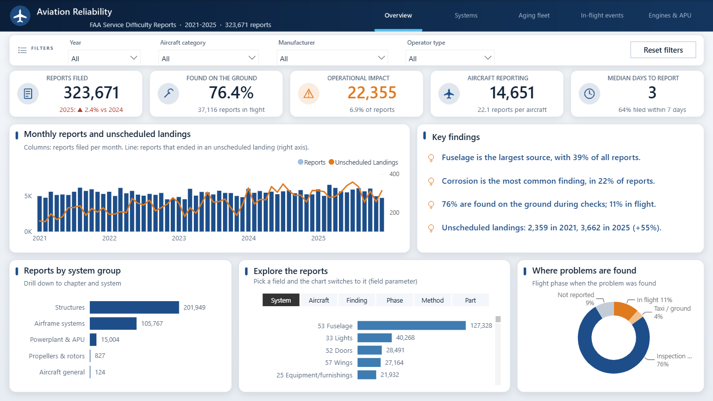
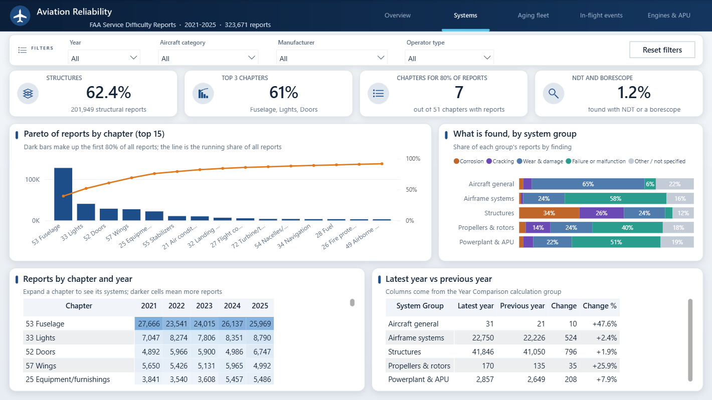
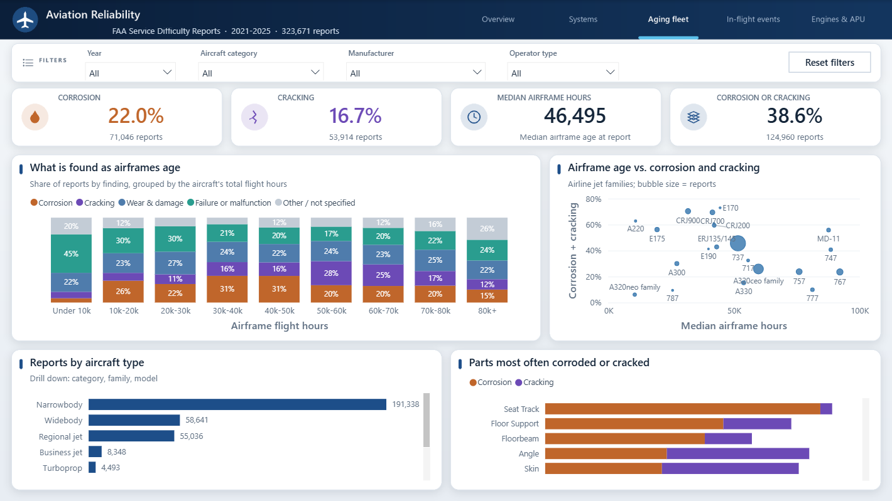
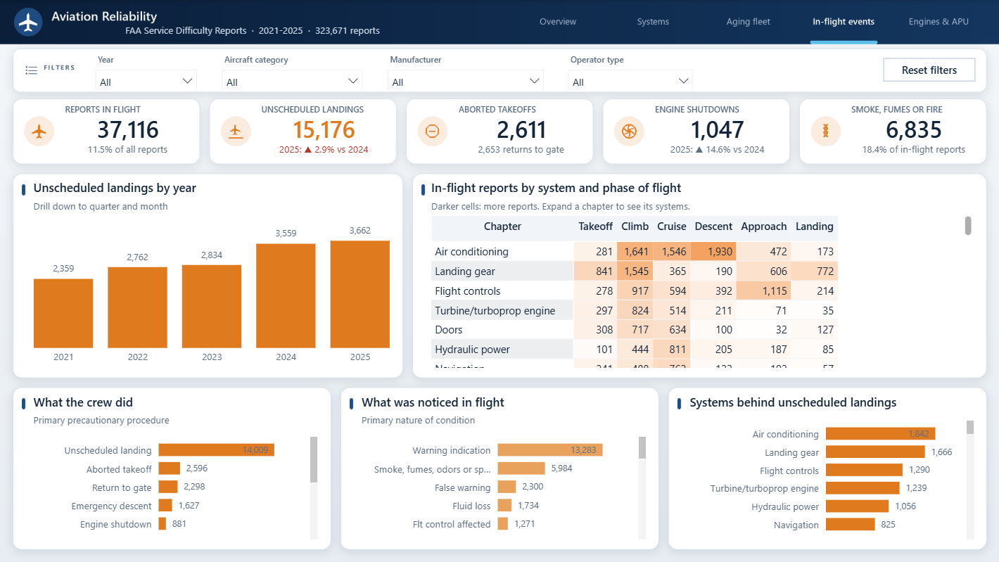
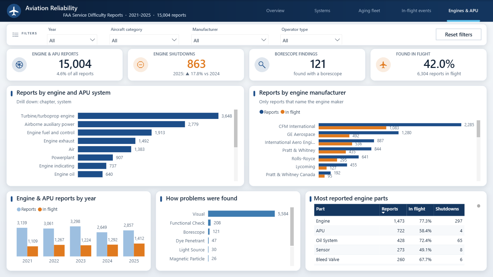

# Aviation Reliability Dashboard

A Power BI report on every Service Difficulty Report (SDR) filed with the FAA in
2021-2025: 323,671 reports from airlines, repair stations and mechanics about failures,
malfunctions and defects they found on aircraft. The report shows which systems
generate the most problems, how findings change as airframes age, and what happens
when a problem shows up in flight.

Everything is done in Power BI: Power Query loads the FAA files and builds the star
schema, and the analysis is in DAX.



## What the data shows

- **Most problems are found on the ground.** 76% of reports come from inspections and
  maintenance; 11% show up in flight.
- **The fuselage dominates.** Chapter 53 (fuselage) is 39% of all reports, and seven of
  the 51 chapters with reports make up 80% of the total. Structures as a group are 62%.
- **Corrosion first, then cracking.** Corrosion's share of findings peaks at 30k-50k
  airframe hours (31%), while cracking peaks later, at 50k-70k hours (28%). Newer
  fleets such as the A320neo family report almost none of either (6%).
- **Emergency lighting is the second largest source.** Chapter 33 (lights) has 40,268
  reports, 92% of them emergency lighting: lights, battery packs and power supplies
  found inoperative or failing their test.
- **Unscheduled landings are rising faster than reports.** Reports that ended in an
  unscheduled landing went from 2,359 in 2021 to 3,662 in 2025 (+55%), while total
  reports grew 5%. Air conditioning and pressurization, landing gear and flight
  controls are the most common systems behind them.
- **Engine problems surface in flight.** Engine and APU systems are only 4.6% of
  reports, but 42% of them come up in flight (against 11% overall), and the in-flight
  count rose from 1,109 in 2021 to 1,412 in 2025 (+27%).

An SDR records a finding, not a flight, so counts also reflect fleet size and how
thoroughly operators report. The report compares shares and mixes rather than ranking
operators.

## Report pages

| Page | What it answers |
|---|---|
| Overview | How many reports, where they are found, which systems; a "Key findings" panel written by DAX measures, and an explorer chart that switches between six fields (field parameter) |
| Systems | Pareto of reports by chapter, finding mix by system group, chapter-by-year heat map, latest year vs. previous year (calculation group) |
| Aging fleet | Finding mix by airframe hours, airframe age vs. corrosion and cracking by aircraft family, parts most often corroded or cracked |
| In-flight events | Unscheduled landings, aborted takeoffs, engine shutdowns, smoke or fumes; heat map of systems by phase of flight |
| Engines & APU | Engine and APU systems, engine manufacturers, discovery methods, most reported engine parts |
| Report details | Drill-through page with the individual reports and the mechanic's description |

| | |
|---|---|
|  |  |
|  |  |

## Power BI features used

- **Power Query:** one function per source reads a yearly FAA file (from a local
  folder, or from the FAA site with `Web.Contents` and `RelativePath`), combines the
  years, cleans dates and numbers, derives flags from the multi-value procedure and
  condition fields, and maps 8,693 FAA aircraft codes to families with a rule table.
- **Model:** star schema, one fact table and ten dimensions, date table, hierarchies
  for drill-down (date, system, aircraft).
- **DAX:** 79 measures in display folders; a `Year Comparison` calculation group that
  the year-over-year measures reuse; a Pareto running share across all chapters; text measures
  for KPI captions, dynamic titles and the Key findings panel.
- **Interaction:** drill-down (system group > chapter > system, category > family >
  model, year > month, year > quarter > month), drill-through to the Report details page, a
  report-page tooltip, a field parameter, synced slicers and a reset button.
- **Design:** custom theme, page backgrounds with a header navigation bar, conditional
  formatting (Pareto colors, heat maps, red/green year-over-year captions).

The data model is described in [docs/data_model.md](docs/data_model.md), and the data
sources in [data/README.md](data/README.md).

## Running it

You need Power BI Desktop (Windows).

1. Clone the repository and download the FAA files (about 165 MB) into `data\raw`:

   ```powershell
   powershell -ExecutionPolicy Bypass -File data\download_sdr.ps1
   ```

2. Open `powerbi/AviationReliability.pbip`, go to Transform data > Edit parameters and
   set `DataFolder` to the repository's `data\` folder (with the trailing backslash).
3. Refresh. The full refresh takes about a minute. The data isn't committed, so the
   visuals show (Blank) until this first refresh. After you save, Power BI keeps the data
   in a local cache (`.pbi/cache.abf`, ignored by git) and the report opens with data from
   then on.

`FirstYear` and `LastYear` change the period. Setting `SourceMode` to `Web` makes Power
Query read the same files straight from the FAA site and the reference tables from this
repository instead of the local folder; Power BI asks how to connect to each site the
first time (Anonymous).

## Layout

```text
powerbi/   Power BI project (.pbip): model as TMDL, report as PBIR, theme,
           readable copies of the DAX measures and Power Query code
data/      reference tables (FAA code lists, aircraft families) and the download script
docs/      data model notes and screenshots
```

## Data

Federal Aviation Administration, Service Difficulty Reporting System,
https://www.faa.gov/av-info/download_SDR. US government data, public domain.

---
Saba Tamizi · [GitHub](https://github.com/SabaTamizi-eng)
