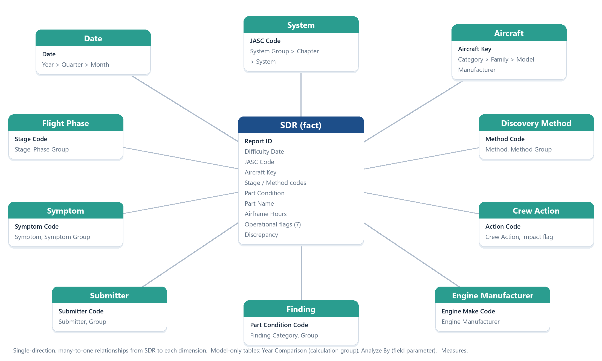

# Data model

A star schema with one fact table (one row per Service Difficulty Report) and ten
dimensions. Everything is built in Power Query; there are no calculated columns.

## Tables

| Table | Grain | Source | Notes |
|---|---|---|---|
| `SDR` | one report | FAA yearly CSV files | 323,671 rows for 2021-2025 |
| `Date` | day | generated in Power Query | marked as the date table; `Calendar` hierarchy Year > Quarter > Month |
| `System` | JASC code | `jasc_codes.csv` | 548 codes; hierarchy System Group > Chapter > System |
| `Aircraft` | make + model | `aircraft_models.csv`, `aircraft_makes.csv`, `aircraft_families.csv` | 8,693 make/model pairs; hierarchy Category > Family > Model |
| `Flight Phase` | stage of operation | `stage_of_operation.csv` | grouped into In flight, Taxi / ground, Inspection & maintenance |
| `Discovery Method` | how discovered | `how_discovered.csv` | grouped into Visual, NDT & borescope, Functional check |
| `Symptom` | nature of condition | `nature_of_condition.csv` | the first (primary) condition on the report |
| `Crew Action` | precautionary procedure | `precautionary_procedure.csv` | the first (primary) procedure; `Operational Impact` flag |
| `Submitter` | submitter type | `submitter_type.csv` | Part 121, 135, 145, 129 and others |
| `Finding` | part condition | `part_conditions.csv` | 350 FAA conditions mapped to 9 categories and 5 groups |
| `Engine Manufacturer` | engine make | `engine_makes.csv` | only about 3% of reports name the engine |
| `Analyze By` | field parameter | DAX | switches the Overview explorer chart between six fields |
| `Year Comparison` | calculation group | DAX | Selected years, Latest year, Previous year, Change, Change % |

All relationships are single-direction, many-to-one from `SDR` to the dimension.

## Cleaning in Power Query (`SDR`)

- Trims every field and turns empty strings into nulls.
- Parses `DifficultyDate` (MM/dd/yyyy) and the ISO `SubmissionDate`; keeps reports dated
  inside the `FirstYear`-`LastYear` window.
- `Days to Submit` = submission date - difficulty date; negative values or more than a
  year are treated as bad dates.
- `Airframe Hours` from `AircraftTotalTime`; zero or over 200,000 hours is treated as
  not reported. Banded in 10,000-hour steps for the aging analysis.
- A report can list up to four precautionary procedures and three conditions. The
  primary code goes to the dimension; flags (`Unscheduled Landing`, `Aborted Takeoff`,
  `Engine Shutdown`, `Return to Gate`, `Emergency Descent`, `Operational Impact`,
  `Smoke or Fumes`) look at all of them.
- The mechanic's description is cut to its first 300 characters for the detail page.

## Aircraft families

The FAA aircraft codes are very specific (`7377H4` is a 737-700 delivered to Southwest).
`aircraft_families.csv` maps them to families with a make, a model prefix and an
optional suffix. The longest matching prefix wins, and a rule with a suffix beats one
without, which is how A320neo models (`A320271N`, `A321253NX`) are told apart from
the ceo. The rules cover 98% of reports; the rest fall back to
"&lt;manufacturer&gt; (other)" with a default category for that manufacturer.

## Measures

79 measures in display folders: Volume, Operational impact, Findings, Reporting,
Pareto, Labels and Formatting. A readable copy is in
[powerbi/measures.dax](../powerbi/measures.dax). A few worth pointing out:

- **Year-over-year** measures and labels reuse the `Year Comparison` calculation group
  (`CALCULATE ( [Reports], 'Year Comparison'[Comparison] = "Change %" )`) instead of
  repeating the time logic in every measure.
- **Pareto Cumulative Share** ranks every chapter (it removes the chapter filter but
  keeps the slicers), so the chart can show only the top 15 chapters while the running
  share is still a share of all reports.
- **Insight** measures build the sentences in the Key findings panel from the data, so
  they change with the filters.
